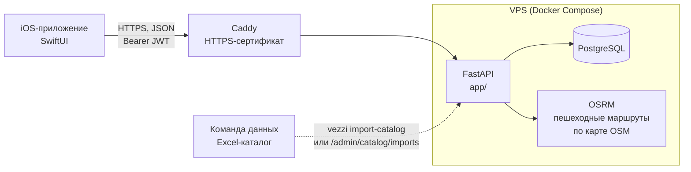
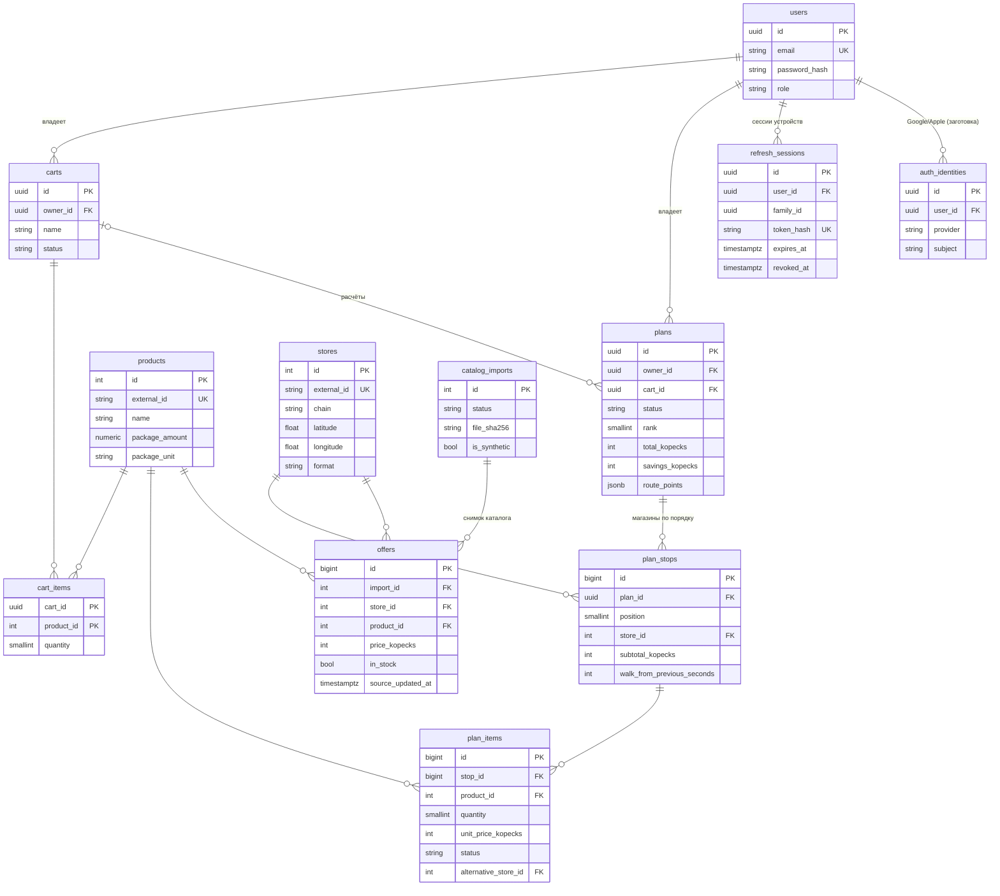

# Архитектура backend

## Общая схема

Наружу открыт только Caddy (порты 80 и 443). PostgreSQL и OSRM доступны только внутри Docker-сети.

## Слои кода

Запрос проходит слои сверху вниз. Каждый слой знает только о тех, что ниже.

| Слой | Папка | Отвечает за |
|---|---|---|
| HTTP | `app/api/` | URL, валидацию входа, права (`CurrentUser`, `AdminUser`), коды ответов |
| Сценарии | `app/services/` | Бизнес-операции: «зарегистрировать», «добавить в корзину», «сравнить сети», «посчитать планы», «начать план» |
| Алгоритм | `app/planner/` | Чистые функции расчёта. Не знают про БД и HTTP, поэтому легко тестируются |
| Внешние сервисы | `app/routing/` | Общий интерфейс `RoutingProvider` и его реализации |
| Данные | `app/models/` | Таблицы PostgreSQL через SQLAlchemy |
| Форматы | `app/schemas/` | Pydantic-схемы запросов и ответов; из них FastAPI строит Swagger |

Ошибки сервисы сообщают исключениями из `app/core/errors.py` (`NotFoundError`, `BusinessRuleError`...).
Обработчик превращает их в JSON `{code, message, request_id, details}`, поэтому формат ошибок везде одинаковый.

## Путь одного запроса: расчёт планов

`POST /api/v1/carts/{id}/plans`

1. **Middleware** (`core/logging.py`) присваивает запросу `request_id` и засекает время.
2. **FastAPI** проверяет JSON по схеме `PlanRequest`: лимит магазинов 1–5, время 10–180 минут.
3. **Зависимость** `get_current_user` (`api/deps.py`) проверяет подпись JWT и находит пользователя.
4. **Роутер** вызывает `services/planning.calculate_plans`.
5. **Сервис:**
   - загружает корзину и проверяет, что она принадлежит пользователю (чужая даёт 404);
   - применяет подтверждённые замены товаров;
   - берёт из активного снимка каталога свежие (не старше 24 часов) предложения в наличии;
   - выбирает до 8 ближайших магазинов и запрашивает у OSRM матрицу пешего времени;
   - вызывает `planner.find_plans`: перебор наборов магазинов и порядков обхода;
   - для каждого из 3 лучших планов запрашивает у OSRM линию маршрута;
   - сохраняет планы со статусом `planned` вместо невыбранных планов прошлого расчёта, а для каждой
     позиции записывает запасной магазин этого же маршрута.
6. **Ответ** `PlanResponse` уходит клиенту, middleware пишет в лог строку с путём, статусом и временем.

Дальше пользователь выбирает план (`POST /plans/{id}/start`), отмечает позиции в магазине и завершает
план. Эти шаги в `services/plans.py`: короткие функции, каждая проверяет владельца и текущий статус.

## Схема базы данных

Основные решения:

- **Деньги в целых копейках** (`price_kopecks`). У float бывают ошибки округления: `0.1 + 0.2 != 0.3`.
- **Фасовка в базовых единицах**: граммы, миллилитры, штуки или метры, `NUMERIC(10, 3)`. «0,93 л»
  хранится как 930 мл, «41,5 г» как 41,5 г.
- **UUID для пользовательских данных, int для каталога.** Идентификатор корзины или плана нельзя угадать
  перебором, а `/products/42` удобно читать.
- **Составной ключ позиции корзины** `(cart_id, product_id)`: один товар в корзине может быть
  только один раз, это гарантирует сама база.
- **План хранит копию цен**, а не ссылку на предложение. Предложения меняются с каждой загрузкой каталога,
  а история должна показывать то, что было на самом деле.
- **Один начатый план на корзину**: частичный уникальный индекс `uq_plans_single_active_per_cart`.
- **Снимки каталога.** Цены привязаны к загрузке (`catalog_imports`). Активен ровно один снимок, это
  обеспечивает частичный уникальный индекс. Новый снимок публикуется одной транзакцией.
- **Время цены от источника** (`source_updated_at`), а не время загрузки: повторная загрузка старой цены
  не делает её свежей.
- **CHECK-ограничения в БД**: цена больше нуля, количество 1–99, допустимые значения перечислений.
  Даже ошибка в коде не запишет в базу некорректные данные.
- **ON DELETE CASCADE**: удаление аккаунта одной командой удаляет корзины, планы и сессии.
  Удаление корзины план не удаляет: `plans.cart_id` становится `NULL` (`ON DELETE SET NULL`).

## Почему так, а не иначе

- **Монолит, без Redis, Celery и микросервисов.** Для MVP с одним backend-разработчиком это проще
  объяснить, развернуть и отладить. Ежедневный импорт запускается cron'ом через CLI.
- **Синхронный SQLAlchemy и обычные `def`-эндпоинты.** FastAPI выполняет их в пуле потоков.
  Асинхронность здесь не дала бы измеримой пользы, а код стал бы сложнее.
- **Алгоритм отдельно от БД.** Контрольный пример из ТЗ проверяется unit-тестом за миллисекунды,
  без базы и сети.
